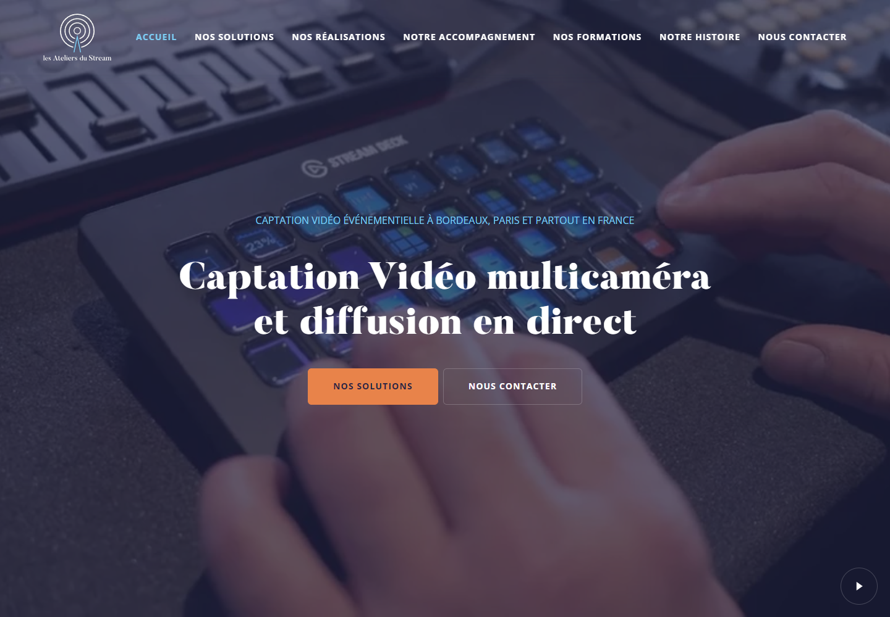
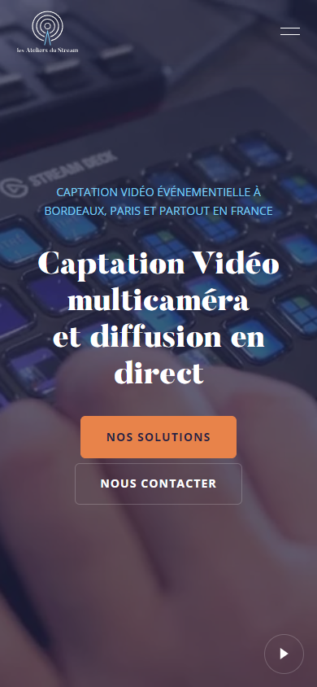
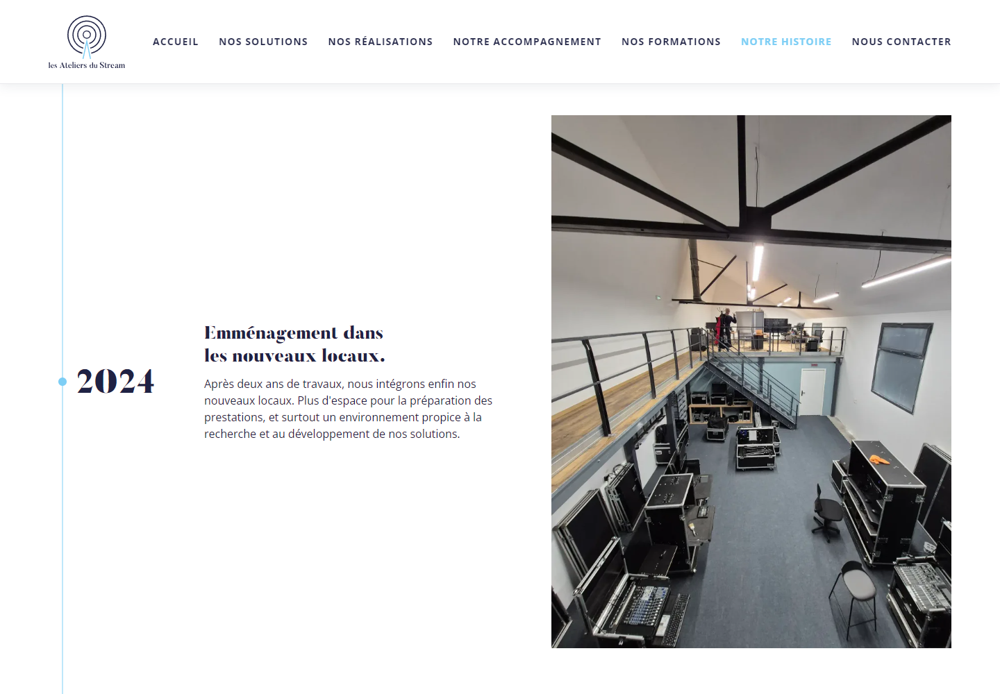

# Refonte Astro et Lumos — dossier de revue

> **Complément vidéos validé localement le 12 novembre 2026.** Le propriétaire autorise sa publication sur la même PR #4, maintenue en brouillon pendant les contrôles GitHub puis prête à relire après leur réussite. Aucune fusion ni mise en ligne autorisée. Voir [le bilan des vidéos locales](videos-locales.md). Les résultats historiques ci-dessous concernent la première refonte.

Version locale validée par le propriétaire le **12 novembre 2026**, après présentation et ajustements, dont le centrage de la frise. Publication autorisée sur `feat/refonte-astro-lumos`, avec une seule PR vers `main`, en brouillon pendant les contrôles puis prête à relire. **La fusion et la mise en ligne ne font pas partie de cette autorisation.**

## Résultat proposé

```text
HTML historiques et médias → Astro + composants Lumos → dist/ (40 routes HTML)
```

- Migration des 34 pages de contenu, cinq anciennes redirections et de la 404. L’export reste statique, en fichiers `.html`, avec URL publiques sans extension, domaine, ancres, métadonnées, données structurées et sitemap conservés.
- Composants natifs Lumos for Astro 1.0.3, styles par rôle et échelles natives ; navigation, pied de page et blocs communs mutualisés. Polices Butler/Open Sans, couleurs, textes et médias conservés, avec les ajustements de hiérarchie et d’espacement validés. Conteneur de 1 300 px.
- Vidéo d’accueil servie localement, sans S3, avec version mobile et poster. Réparation de la lightbox tronquée, des liens de contact et du menu clavier ; SVG de contact recolorables, année courante dynamique et défilement doux respectant la réduction des mouvements.
- Header transparent sur l’accueil puis blanc au défilement, blanc dès le chargement sur les pages internes ; lien Accueil, états actifs bleu clair et bandeaux internes harmonisés. Animation des titres et boutons du hero, interactions des boutons et cartes de solutions plus lisibles.
- Frise « Notre histoire » : huit étapes, trois colonnes sur bureau, textes et années centrés verticalement sur les médias, photos entières, lecteurs 16:9 et progression ScrollTrigger réversible. Contenus visibles sans JavaScript.
- Parcours formations et intégrations EVA conservés : sessions, résultats, inscriptions externes, paramètres de retour, événements, repli réseau et opposition aux statistiques. Les six lecteurs Vimeo sont remplacés dans le complément local par des MP4 natifs ; YouTube et Wisio sont conservés. Aucun CMS ajouté.

Le crédit demandé dans [le ticket #3](https://github.com/Lads47/lads-website/issues/3), déjà clos, est conservé dans les mentions légales. Aucun ticket ouvert de refonte n’existait au moment de cette proposition.

## Vérifications locales après installation propre

Commandes exécutées sur Windows avec Node 26 : `npm ci`, `npm run check`, `npm run build`, `npm test`, puis `npm run test:browser` sur le build servi localement.

| Contrôle | Résultat |
| --- | --- |
| Installation verrouillée | 272 paquets installés ; aucune vulnérabilité signalée par npm |
| Astro/TypeScript | 125 fichiers, aucune erreur, aucun avertissement |
| Build statique | 40 routes |
| Contenus et SEO | Textes, métadonnées, JSON-LD et médias vérifiés par les fixtures ; 1 181 liens locaux et ancres valides |
| Composants et tokens | 5 760 déclarations contrôlées ; 89 sections, 70 grilles et 65 cartes dans les sources de contenu |
| Rendus | 35 pages à 1 440 et 390 px, soit 70 captures ; cinq gabarits tablette |
| Navigation | 68 parcours de header, menu mobile, clavier, Échap, retour du focus, ancres et repli sans scripts |
| Interactions | Lightboxes, vidéo MP4 locale (lecture/pause/reprise), réduction des mouvements, opposition EVA persistante |
| EVA | Huit scénarios simulés : sessions, aucune session, panne et résultats publics sur les deux formations ; aucune inscription transmise |
| Frise | Huit étapes à sept largeurs, texte à 200 %, contraste et proportions ; 64 franchissements aller/retour, restauration et redimensionnement |
| Anciennes URL | Cinq redirections et réponse 404 vérifiées |

Les tests navigateur neutralisent les services tiers et masquent les lecteurs dans les captures exhaustives pour assurer leur reproductibilité. Ils ne certifient pas la lecture réelle de chaque vidéo externe ni le rendu dynamique de Wisio. Les rapports et captures complets sont dans `test-results/` ; le workflow GitHub les conserve en artefacts pendant 14 jours. Les résultats Linux doivent être lus sur la PR, distinctement des résultats locaux Windows. La CI utilise Ubuntu 24.04 et son Chrome stable préinstallé, sélectionné explicitement via `BROWSER_PATH`, comme pour les contrôles locaux. Le premier essai sur `ubuntu-latest` utilisait Ubuntu 26.04 et échouait à installer Chromium ; l’installateur sur Ubuntu 24.04 est ensuite resté bloqué plus de cinq minutes. Le recours au navigateur déjà installé conserve toute la suite et évite cette installation supplémentaire. Le workflow journalise la version du navigateur utilisée.

## Captures représentatives

Le contrôle du header attend la fin réelle de ses transitions avant de comparer les couleurs : la première exécution navigateur Linux lisait parfois un blanc transitoire sérialisé `rgba(..., 1)` au lieu du `rgb(...)` final. Les assertions de couleur et d’opacité restent strictes ; aucun style du site n’a été modifié pour ce correctif de synchronisation.

Le test d’introduction du hero vérifie le déplacement sur toute la trajectoire échantillonnée : une première mesure antérieure au positionnement initial de GSAP peut être identique à la dernière, malgré un mouvement intermédiaire réel. L’amplitude doit dépasser un pixel, en complément des contrôles d’opacité, de stabilité du titre, de focus et de mouvement réduit. L’animation du site reste inchangée.

Ces trois captures proviennent du build validé, sans masque de lecteur sur les zones montrées. Le mode de réduction des mouvements conserve le poster local de l’accueil et désactive les introductions ; les services externes sont neutralisés. Elles montrent l’état final des composants. Les captures exhaustives sont disponibles dans les artefacts du workflow.

### Accueil — bureau, 1 440 px



### Accueil — mobile, 390 px



### Frise — bureau, 1 440 px



## Revue du diff a4a2643…9c2b729

### Standards

Aucune violation certaine des standards documentés, ni smell nécessitant une correction avant publication, dans la revue de la CI, de la prévisualisation, des médias, des intégrations EVA, des composants partagés, des animations et des tokens. La revue initiale signalait la nécessité d’une exécution Linux distincte ; la CI et le local utilisent désormais Chrome, mais leurs systèmes restent différents.

### Spec

Aucun défaut concret bloquant identifié par rapport au mandat et aux décisions consignées. Export, routes, médias, paramètres et événements EVA, lecteurs et parcours formations examinés. Les états documentaires historiques « validation en attente » ont été actualisés ou datés dans cette préparation.

Bilan : Standards — 0 constat bloquant ; Spec — 0 constat bloquant. Les intégrations externes réelles et la CI Linux restent des limites de cette revue locale.

## Limites connues et livraison ultérieure

- **Vidéos locales** : les six lecteurs Vimeo sont remplacés dans le complément validé localement. Les droits Vimeo restent inchangés. Source, poids et contrôles dans [le bilan vidéo](videos-locales.md).
- **Wisio** : l’ancienne URL du widget renvoie une page HTML ; défaut préexistant documenté séparément et non réparé dans ce lot.
- **Textes** : contradictions conservées volontairement, dont les dates CECA/Ekivia, nombres de caméras, ancienneté fixe et mentions légales devenues incomplètes. Liste dans [le rapport historique](rapport-verification.md#textes-et-incohérences-conservés).
- **Accessibilité connue** : le bleu clair actif/survol du menu sur fond blanc conserve le contraste faible demandé ; ce choix n’est pas revendiqué conforme AA. À 200 % sur petit écran, le courriel du contact/pied de page peut dépasser ; la frise ne déborde pas.
- **Hébergement** : aucune modification ni publication. Le workflow ne déploie rien. L’existence d’une connexion extérieure entre GitHub et l’hébergeur reste à vérifier avant toute fusion ou livraison.

La [procédure de remplacement et de retour arrière](livraison.md) prévoit l’identification de l’hébergement, la sauvegarde du site réellement publié, la validation d’une copie de préproduction et la livraison du seul dossier `dist/`. Le serveur Node local n’est pas à installer en production. Le retour arrière Git est possible ; la restauration d’un site publié dépend de la sauvegarde d’exploitation, préparée lors de cette étape ultérieure.
